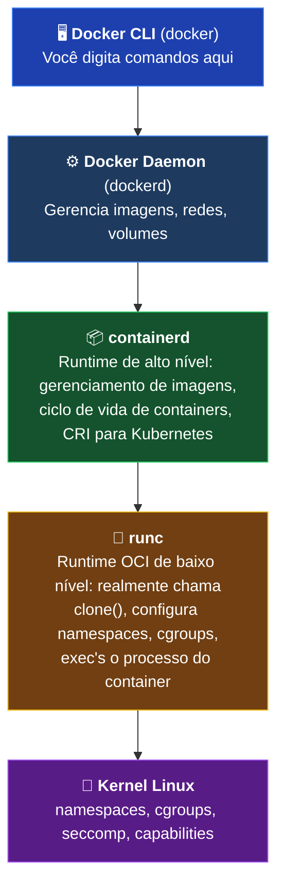

# Capítulo 2: Containers Desmistificados

*"Um container é apenas um processo Linux que pensa que está sozinho na máquina."*

---

## Não Existe "Container" de Verdade

Esse título pode parecer provocativo em um livro de Kubernetes, mas é a coisa mais importante que você vai aprender neste capítulo: **não existe uma primitiva container no kernel Linux.** Não há uma chamada de sistema `container_create()`. Nenhuma entrada "container" em `/proc`.

O que chamamos de "container" é na verdade um processo Linux comum com três coisas extras aplicadas:

1. **Namespaces** — para que o processo pense que tem sua própria árvore de PIDs, pilha de rede e sistema de arquivos
2. **cgroups** — para que o processo só possa usar uma quantidade definida de CPU e memória
3. **Um sistema de arquivos raiz** (de uma imagem) — para que o processo veja um `/` completamente diferente do host

É isso. Se você já usou `chroot`, já usou uma forma primitiva de containerização. Se já configurou cgroups para um serviço, já fez limitação de recursos. Docker, containerd e Kubernetes não inventaram essas funcionalidades — eles as tornaram *usáveis*.

Como profissional Linux, você já entende os blocos de construção. Este capítulo os desmonta, mostra como se encaixam e revela o que o Docker (e eventualmente o Kubernetes) realmente está fazendo por baixo dos panos.

## Namespaces Linux: A Camada de Isolamento

Namespaces são a funcionalidade do kernel que dá a um processo sua própria visão isolada do sistema. Pense neles como espelhos unidirecionais: o host pode ver tudo, mas o processo em namespace só vê seu próprio pequeno mundo.

O Linux oferece vários tipos de namespace, cada um isolando um recurso diferente do sistema:

| Namespace | Flag | O Que Isola | Analogia Linux |
|-----------|------|------------------|---------------|
| **PID** | `CLONE_NEWPID` | IDs de processo — o container vê seu entrypoint como PID 1 | Como um boot limpo onde seu processo é o `init` |
| **NET** | `CLONE_NEWNET` | Interfaces de rede, endereços IP, tabelas de roteamento, portas | Como uma máquina separada com seu próprio `eth0` |
| **MNT** | `CLONE_NEWNS` | Pontos de montagem — o container tem sua própria árvore de sistema de arquivos | Como `chroot` turbinado |
| **UTS** | `CLONE_NEWUTS` | Hostname e nome de domínio | Como definir um hostname diferente por serviço |
| **IPC** | `CLONE_NEWIPC` | Comunicação entre processos (memória compartilhada, semáforos) | Como domínios System V IPC separados |
| **USER** | `CLONE_NEWUSER` | Mapeamentos de IDs de usuário e grupo — root dentro pode corresponder a um UID sem privilégios fora | Um mapeamento de UID/GID separado, não um `/etc/passwd` separado |
| **cgroup** | `CLONE_NEWCGROUP` | Diretório raiz de cgroup — o container vê sua própria hierarquia de cgroup como raiz | Como uma visão privada de `/sys/fs/cgroup/` |

Quando o Docker inicia um container, ele está chamando as mesmas APIs do kernel que `unshare` e `clone()` usam. A "mágica" dos containers é apenas criação de namespace — algo que o Linux suporta desde o kernel 2.6.24 (2008) e que amadureceu com user namespaces no kernel 3.8 (2013).

### Como os Namespaces Trabalham Juntos

Um container Docker típico em modo rootful usa namespaces PID, NET, MNT, UTS, IPC e cgroup separados, mas **não recebe um user namespace separado por padrão**. O processo interno:
- Se vê como PID 1 (PID namespace)
- Tem suas próprias interfaces `lo` e `eth0` (NET namespace)
- Vê um sistema de arquivos raiz completamente diferente (MNT namespace)
- Tem seu próprio hostname (UTS namespace)
- Não pode acessar a memória compartilhada do host (IPC namespace)
- Pode mapear root para um UID sem privilégios no host quando o remapeamento de user namespaces ou o modo rootless está habilitado (USER namespace)

Sem remapeamento de user namespaces, o UID 0 dentro ainda é o UID 0 no host Linux do daemon. Capabilities, seccomp e outros controles restringem o que ele pode fazer, mas não confunda essas restrições com um UID diferente. Um user namespace muda os mapeamentos de identidade, não apenas o banco de dados de usuários.

> **Fonte:** [Docker — Isolar containers com um user namespace](https://docs.docker.com/engine/security/userns-remap/)

Da **perspectiva do host**, esse mesmo processo é apenas mais uma entrada no `ps aux` com um PID normal. Não há nada especial nele — é um processo Linux normal com alguns metadados extras do kernel restringindo o que ele pode ver.

## cgroups v2: O Limitador de Recursos

Enquanto namespaces lidam com **isolamento** (o que um processo pode ver), cgroups lidam com **limites de recursos** (o que um processo pode usar). cgroups — abreviação de "control groups" — permitem definir limites rígidos em CPU, memória, I/O e mais.

Sistemas Linux modernos usam **cgroups v2** (hierarquia unificada), que organiza o controle de recursos sob uma única árvore em `/sys/fs/cgroup/`. Aqui está o que os principais controllers fazem:

| Controller | Arquivo de Interface | O Que Controla |
|-----------|---------------|-----------------|
| **CPU** | `cpu.max` | Tempo máximo de CPU (quota/período em microssegundos) |
| **CPU** | `cpu.weight` | Compartilhamento proporcional de CPU (substitui o `cpu.shares` do v1) |
| **Memory** | `memory.max` | Limite rígido de memória — OOM-killed se excedido |
| **Memory** | `memory.low` | Proteção de memória best-effort (garantia soft) |
| **I/O** | `io.max` | Limites de taxa de I/O por dispositivo (bytes/s, IOPS) |
| **PIDs** | `pids.max` | Número máximo de processos no grupo |

Quando você executa `docker run --memory=128m --cpus=0.5`, o Docker está fazendo exatamente isso por baixo dos panos:
- Escrevendo `134217728` (128 MB em bytes) em `memory.max`
- Escrevendo `50000 100000` em `cpu.max` (50ms de CPU a cada 100ms = 0.5 CPUs)

Não há mágica do Docker aqui — são interfaces puras do kernel.

## Imagens OCI: Sistemas de Arquivos Imutáveis e em Camadas

Agora que cobrimos isolamento (namespaces) e limites de recursos (cgroups), a terceira peça é o **sistema de arquivos**. Um container precisa ver um sistema de arquivos raiz (`/`) com todos os seus binários, bibliotecas e arquivos de configuração. É isso que uma imagem OCI (Open Container Initiative) fornece.

### Como as Camadas Funcionam

Uma imagem não é um único arquivo — é uma pilha de **camadas somente-leitura**, cada uma representando um conjunto de mudanças no sistema de arquivos. Pense nisso como controle de versão para sistemas de arquivos:

```
Layer 4: COPY app.py /app/           ← Código da sua aplicação
Layer 3: RUN pip install flask        ← Pacotes instalados
Layer 2: RUN apt-get install python3  ← Runtime do Python
Layer 1: FROM ubuntu:24.04            ← Sistema de arquivos base do SO
```

Cada camada armazena apenas o **diff** da camada abaixo. Este design tem enormes vantagens:

- **Camadas compartilhadas**: Se 10 containers usam `ubuntu:24.04`, essa camada base é armazenada uma vez no disco e compartilhada entre todos
- **Builds rápidos**: Mudou o código da aplicação? Apenas a Layer 4 é reconstruída — layers 1-3 estão em cache
- **Imutabilidade**: Camadas são somente-leitura. Quando um container escreve arquivos, essas escritas vão para uma fina **camada gravável** por cima (usando um sistema de arquivos union como OverlayFS)

### O Dockerfile: Construindo Imagens

Um Dockerfile é uma receita para construir uma imagem, camada por camada. Aqui estão as instruções principais:

| Instrução | Propósito | Analogia Linux |
|-------------|---------|---------------|
| `FROM` | Define a imagem base (sistema de arquivos inicial) | Como escolher qual distro instalar |
| `RUN` | Executa um comando durante o build (cria uma nova camada) | Como executar um comando em um script de provisionamento |
| `COPY` | Copia arquivos da sua máquina para dentro da imagem | Como `cp` ou `scp` durante a configuração |
| `ENV` | Define variáveis de ambiente | Como adicionar ao `/etc/environment` |
| `EXPOSE` | Documenta em qual porta a aplicação escuta | Como um comentário na sua config de firewall (não abre portas de verdade) |
| `CMD` | Comando padrão quando o container inicia | Como `ExecStart=` em uma unit do systemd |
| `ENTRYPOINT` | O executável principal (CMD se torna seus argumentos) | Como o caminho do binário em `ExecStart=`, com CMD como os argumentos |

**Distinção importante:** `CMD` fornece padrões que podem ser sobrescritos em tempo de execução (`docker run myimage /bin/sh`). `ENTRYPOINT` define o executável que sempre roda, e `CMD` apenas fornece argumentos padrão para ele. A maioria das imagens de produção usa `ENTRYPOINT` para o binário principal e `CMD` para flags padrão.

## Container Runtimes: A Pilha

Quando você executa `docker run nginx`, um número surpreendente de componentes está envolvido. Entender a pilha ajuda a desmistificar o que está realmente acontecendo:



Aqui está o insight principal: **Kubernetes não precisa do Docker Engine.** O Kubernetes v1.24 removeu sua integração embutida com o Docker, o dockershim. Nossos nodes Kind usam **containerd** via Container Runtime Interface (CRI), e depois **runc** para criar os processos dos containers. Outros runtimes CRI, como CRI-O, também são suportados; usar o Docker Engine como runtime do Kubernetes exige um adaptador CRI externo.

O Docker Engine é útil no desenvolvimento e executa os containers dos nossos nodes Kind. Dentro desses nodes, containerd e runc executam as workloads do Kubernetes. Entender essas duas camadas importa: problemas no runtime das workloads envolvem o containerd do node, enquanto problemas nos containers dos nodes Kind podem envolver o Docker Engine externo.

## Tabela de Comparação Linux ↔ Container

| Conceito Linux | Equivalente em Container | Como Se Mapeia |
|---------------|---------------------|-------------|
| `chroot` | Mount namespace + rootfs | Containers usam um mount namespace completo, não apenas uma raiz alterada |
| `unshare` | Criação de namespace | Docker/runc chama `clone()` com flags de namespace, assim como `unshare` |
| cgroups (`/sys/fs/cgroup/`) | Limites de recursos (`--memory`, `--cpus`) | Mesma funcionalidade do kernel — Docker apenas escreve nos arquivos de cgroup para você |
| Processo (`/proc/<pid>/`) | Container | Um container *é* um processo — ele tem um PID no host |
| Sistema de arquivos (`/`, `/usr`, `/etc`) | Camadas de imagem (OverlayFS) | Em camadas e somente-leitura, diferente de um sistema de arquivos tradicional mutável |
| PID 1 (`init`/`systemd`) | Entrypoint do container | O processo entrypoint deve continuar rodando — se ele sair, o container para |
| `fork()`/`exec()` | `docker run` | Cria um novo processo com isolamento, apenas com mais passos |

> **Onde a Analogia com Linux Quebra**
>
> - **Imagens são imutáveis e em camadas.** Em um servidor Linux, você pode modificar qualquer arquivo diretamente. Imagens de container são construídas a partir de camadas somente-leitura — escritas em tempo de execução vão para uma camada gravável separada. No Docker, essa camada sobrevive a `docker stop` e `docker start` do mesmo container; ela é descartada quando o container é **removido** (`docker rm` ou remoção automática com `--rm`). Um container recém-criado parte da imagem novamente. Use volumes ou bind mounts para dados que precisam sobreviver a um container. Reinícios de containers no Kubernetes criam um novo container com uma camada gravável nova.
>
> - **O entrypoint deve continuar rodando.** Em um servidor Linux, se um serviço cai, o systemd o reinicia. Em um container, se o PID 1 sai, o container morre imediatamente. Não há sistema init dentro para reiniciar. (Esse é o trabalho do Kubernetes — ele reinicia o *container*, não o processo dentro dele.)
>
> - **A rede é completamente isolada por padrão.** Processos do host compartilham a mesma pilha de rede — todos podem fazer bind em portas, ver as mesmas interfaces e se alcançar via `localhost`. Um container recebe seu próprio network namespace com suas próprias interfaces. Para alcançar o container a partir do host, você precisa de mapeamento explícito de portas (`-p 8080:80`) ou uma rede de containers.

## Lab de Diagnóstico: Containers do Zero

Este lab mostra que containers são apenas funcionalidades do Linux — nenhuma mágica necessária. Você vai criar namespaces manualmente, construir uma imagem, inspecionar suas camadas e provar que containers são apenas processos.

### Pré-requisitos

- Uma máquina Linux (ou WSL2 no Windows)
- Docker instalado e rodando
- Acesso root ou sudo (para a seção de `unshare`)

### Exercício 1: Criar um Namespace Manualmente

Este exercício prova que "containers" são apenas funcionalidades do kernel Linux. Usaremos `unshare` para criar namespaces isolados — a mesma coisa que o Docker faz por baixo dos panos.

**Crie um novo PID e mount namespace:**

```bash
sudo unshare --pid --mount --fork --mount-proc bash
```

Dentro deste novo namespace, você está em um espaço de PID isolado. Vamos provar:

```bash
# Check — your shell is PID 1 in this namespace!
echo $$

# List all processes — you'll only see processes in THIS namespace
ps aux
```

Você deve ver muito poucos processos — apenas seu shell e o próprio `ps`. Enquanto isso, no host (em outro terminal), a lista completa de processos é visível. Isso é exatamente o que um container vê.

`--mount-proc` monta um `/proc` novo para o novo PID namespace e mantém essa montagem privada ao exercício.

**Saia do namespace:**

```bash
exit
```

> **O que acabou de acontecer?** Você usou `unshare` para criar novos PID e mount namespaces — as mesmas funcionalidades do kernel que Docker e containerd usam. A única diferença é que o Docker também configura cgroups, rede, um sistema de arquivos raiz baseado em imagem, e faz tudo através de uma API conveniente.
>
> **Fonte:** [unshare(1) — Linux manual page](https://man7.org/linux/man-pages/man1/unshare.1.html)

### Exercício 2: Construir uma Imagem Docker

Crie um diretório de trabalho e um Dockerfile simples:

```bash
mkdir -p ~/container-lab && cd ~/container-lab
```

Crie um Dockerfile:

```dockerfile
FROM ubuntu:24.04
RUN apt-get update && apt-get install -y curl && rm -rf /var/lib/apt/lists/*
COPY <<'EOF' /app/hello.sh
#!/bin/bash
echo "Hello from container! Hostname: $(hostname), PID: $$"
sleep infinity
EOF
RUN chmod +x /app/hello.sh
CMD ["/app/hello.sh"]
```

Construa a imagem:

```bash
docker build -t my-container-lab:v1 .
```

> **Fonte:** [Dockerfile reference](https://docs.docker.com/reference/dockerfile/)

### Exercício 3: Inspecionar Camadas da Imagem

Instruções do Dockerfile como `RUN` e `COPY` criam camadas de sistema de arquivos; instruções apenas de metadados, como `CMD`, não. Vamos inspecionar o histórico do build:

```bash
# Show build history — metadata-only entries can have zero size
docker history my-container-lab:v1
```

Você verá alterações no sistema de arquivos e entradas de metadados com seus tamanhos e comandos de build. O histórico da imagem base pode ocupar várias entradas; compare-as com sua pequena camada `COPY`.

Agora inspecione os metadados completos da imagem:

```bash
# Show detailed image information including layer digests
docker inspect my-container-lab:v1 --format '{{json .RootFS.Layers}}' | python3 -m json.tool
```

Cada hash SHA256 representa uma camada. Imagens compartilhando a mesma imagem base compartilharão as mesmas camadas inferiores — é assim que o Docker economiza espaço em disco.

> **Fonte:** [docker history](https://docs.docker.com/reference/cli/docker/image/history/) | [docker inspect](https://docs.docker.com/reference/cli/docker/inspect/)

### Exercício 4: Limites de Recursos com cgroups

Execute um container com limites de memória e CPU — o Docker traduz estes para configurações de cgroup:

```bash
docker run -d --name limited-container \
  --memory=128m \
  --cpus=0.5 \
  my-container-lab:v1
```

Agora inspecione os limites de cgroup que o Docker configurou:

```bash
# Check the memory limit (in bytes — 128MB = 134217728)
docker exec limited-container cat /sys/fs/cgroup/memory.max

# Check the CPU quota (50000 100000 = 50ms every 100ms = 0.5 CPUs)
docker exec limited-container cat /sys/fs/cgroup/cpu.max
```

Estes são os mesmos arquivos de cgroup que você escreveria manualmente no host. O Docker apenas fornece uma interface conveniente.

Limpeza:

```bash
docker stop limited-container && docker rm limited-container
```

> **Fonte:** [docker run — resource constraints](https://docs.docker.com/reference/cli/docker/container/run/#memory) | [cgroups v2 — Linux kernel docs](https://www.kernel.org/doc/html/latest/admin-guide/cgroup-v2.html)

### Exercício 5: Containers São Apenas Processos

Este é o momento "eureka". Execute um container e prove que é apenas um processo no host:

```bash
# Run a container
docker run -d --name process-proof my-container-lab:v1

# Inspect PID 1 without requiring ps in the minimal Ubuntu image
docker exec process-proof cat /proc/1/status
docker exec process-proof cat /proc/1/comm
```

Agora olhe a lista de processos do **host**:

```bash
# Find the container's process on the HOST — it has a regular PID!
docker top process-proof
```

A saída do `docker top` mostra os processos do container como o **host Linux do daemon os vê** — com PIDs do host. O entrypoint é PID 1 dentro, mas tem outro PID fora. Com Docker Desktop ou um daemon remoto, esses não são PIDs no namespace de processos do seu shell cliente.

**Somente com um Docker Engine local no Linux**, quando seu shell compartilha o PID namespace do host do daemon, você pode encontrá-lo com um simples `ps`:

```bash
# Get the container's PID on the DAEMON host, not the CLI client
docker inspect process-proof --format '{{.State.Pid}}'

# Verify — this is a regular process visible on the host
ps -p $(docker inspect process-proof --format '{{.State.Pid}}') -o pid,ppid,cmd
```

Com Docker Desktop (incluindo um cliente integrado ao WSL), ou qualquer contexto Docker remoto, use `docker top process-proof` em vez disso. Um `ps` no cliente pode não mostrar nada ou mostrar um processo sem relação com o container que tenha o mesmo PID numérico.

**Esta é a revelação fundamental:** Um container não é uma VM. Não é um kernel separado. É um processo Linux com namespaces e cgroups aplicados. O kernel do host roda tudo.

Limpeza:

```bash
docker stop process-proof && docker rm process-proof
rm -rf ~/container-lab
```

> **Fonte:** [docker top](https://docs.docker.com/reference/cli/docker/container/top/) | [docker inspect](https://docs.docker.com/reference/cli/docker/inspect/)

## Principais Conclusões

1. **Um container é um processo Linux** com namespaces (isolamento), cgroups (limites de recursos) e um sistema de arquivos raiz baseado em imagem. Não existe uma primitiva "container" no nível do kernel.
2. **Namespaces Linux** isolam recursos como PIDs, rede, montagens, hostnames, IPC, IDs de usuário e visões de cgroup. O Docker rootful não cria um USER namespace separado por padrão; habilite o remapeamento ou o modo rootless para ter essa fronteira de identidade.
3. **cgroups v2** impõem limites de recursos. Quando você define `--memory=128m`, o Docker escreve no mesmo arquivo `/sys/fs/cgroup/memory.max` que você poderia escrever manualmente.
4. **Imagens OCI são em camadas e imutáveis.** Instruções do Dockerfile que alteram o sistema de arquivos criam camadas; instruções apenas de metadados não. A camada gravável de um container Docker sobrevive a stop/start, mas não à remoção. Camadas base compartilhadas economizam espaço em disco.
5. **Uma pilha típica de runtime do Docker é Docker CLI → dockerd → containerd → runc → kernel Linux.** O Kubernetes usa diretamente um runtime compatível com CRI; nossos nodes Kind usam containerd.
6. **Entrypoints de container são PID 1.** Se o processo entrypoint sai, o container para. Não há sistema init dentro para reiniciar serviços — essa responsabilidade passa para o orquestrador (Kubernetes).
7. **Entender esses fundamentos Linux te dá um superpoder de debugging.** Quando um container se comporta mal, você não está lutando contra mágica — está debugando namespaces, cgroups e comportamento de processos, que você já entende.

## Leitura Adicional

- [Linux Namespaces — man7.org](https://man7.org/linux/man-pages/man7/namespaces.7.html)
- [unshare(1) — Linux manual page](https://man7.org/linux/man-pages/man1/unshare.1.html)
- [Control Group v2 — Linux kernel docs](https://www.kernel.org/doc/html/latest/admin-guide/cgroup-v2.html)
- [OCI Image Specification](https://github.com/opencontainers/image-spec)
- [OCI Runtime Specification](https://github.com/opencontainers/runtime-spec)
- [Dockerfile Reference](https://docs.docker.com/reference/dockerfile/)
- [containerd — CNCF Project](https://containerd.io/)
- [Docker CLI Reference](https://docs.docker.com/reference/cli/docker/)
- [Armazenamento Docker — Fundamentos da Camada do Container](https://docs.docker.com/engine/storage/)

---

**Anterior:** [Capítulo 1 — Do Servidor ao Cluster](01-from-server-to-cluster.md)

**Próximo:** [Capítulo 3 — Arquitetura do Kubernetes](03-kubernetes-architecture.md) — Os componentes do control plane e worker node, mapeados para os serviços e daemons Linux que você já conhece.
